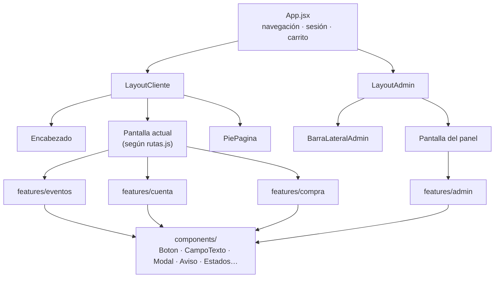
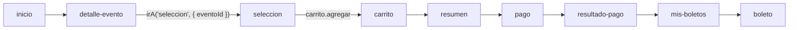

# Arquitectura de componentes y flujo de estado

Cómo está organizada la aplicación: qué componentes la forman, dónde vive el estado y cómo se conectan los módulos de cada integrante.

## Árbol de componentes

## Componentes por módulo

| Módulo del MVP | Carpeta | Responsable | Componentes principales |
|---|---|---|---|
| 1. Usuarios y autenticación | `features/cuenta/` | Gabriel | `LoginPage`, `RegistroPage`, `RecuperarPage`, `PerfilPage`, `TarjetaAuth`, `CampoContrasena` |
| 2. Gestión de eventos | `features/eventos/` | Eddie | `InicioPage`, `ResultadosPage`, `DetalleEventoPage`, `CatalogoEventos`, `TarjetaEvento`, `FiltroCategorias` |
| 3. Inventario y precios | `features/admin/` y `features/eventos/` | Eddie | `InventarioPage`, `FormularioZona`, `ZonasEvento` |
| 4. Proceso de compra | `features/compra/` | Gabriel | `SeleccionPage`, `CarritoPage`, `ResumenPage`, `SelectorZona`, `SelectorCantidad`, `ItemCarrito`, `IndicadorPasos` |
| 5. Sistema de pagos | `features/compra/` | Gabriel | `PagoPage`, `ResultadoPagoPage`, `FormularioPago`, `ResumenCompra` |
| 6. Boletos electrónicos | `features/compra/` | Gabriel | `MisBoletosPage`, `BoletoPage`, `TarjetaBoleto`, `CodigoQR` |
| 7. Panel de administración | `features/admin/` | Eddie | `DashboardPage`, `EventosAdminPage`, `CrearEventoPage`, `UsuariosPage`, `CrearUsuarioPage`, `TablaDatos`, `ModalConfirmacion` |
| 8. Reportes y analítica | `features/admin/` | Eddie | `ReportesPage`, `TarjetaMetrica`, `GraficoBarras` |

Los componentes base de `components/` (`Boton`, `CampoTexto`, `Modal`, `Aviso`, `Etiqueta`, los tres estados, `EnlaceVista` y `Logo`) los usan todos los módulos.

## Flujo de estado

1. **App.jsx** es dueño de tres estados: la vista actual (`useState`), la sesión (`useSesion`) y el carrito (`useCarrito`).
2. Los pasa como props a los layouts y a la pantalla actual: `{ params, irA, sesion, carrito }`.
3. Las pantallas no cambian el estado de App directamente: llaman a funciones (`irA`, `carrito.agregar`, `sesion.iniciarSesion`) y App vuelve a dibujar lo que corresponda.
4. Cada pantalla pide sus propios datos con `usePeticion`, que maneja carga, error y cancelación.
5. Sesión, carrito, órdenes y preferencias se guardan en `localStorage` con `useLocalStorage`.

## Flujo principal de compra

Si una vista pide sesión y no la hay, App muestra `login` y, al iniciar sesión, regresa a la vista que se había pedido.

## Decisiones

- **El estado global vive en `App.jsx`:** la vista actual, la sesión y el carrito se crean una sola vez y bajan por props. Context no se exige en esta entrega; se incorpora en la tercera.
- **Navegación con estado, sin router:** `irA` cambia la vista y la guarda en el historial del navegador, así funcionan el botón Atrás y la recarga.
- **Un contrato fijo entre módulos:** toda pantalla recibe `{ params, irA, sesion, carrito }`. Cada integrante trabajó en sus propias carpetas; los módulos solo se conectan por ese contrato y por los nombres de las vistas.
- **Datos por servicios simulados:** las pantallas no leen los datos directamente: piden a `servicios/` funciones que devuelven promesas con retraso, y `usePeticion` muestra carga, error con reintento y vacío. Al cambiar de pantalla, la petición anterior se cancela con `AbortController`.
- **Valores derivados en lugar de estado duplicado:** totales del carrito, disponibilidad por zona, estado de venta de un evento y métricas de reportes se calculan cada vez, para que nunca queden desactualizados.
- **Persistencia inmediata:** `useLocalStorage` escribe en el momento del cambio, para que no se pierda un dato si la pantalla navega justo después de guardar.
- **Estilos por componente:** cada componente tiene su CSS con clases BEM en español y usa las variables de `tokens.css` del manual de marca. Diseño desde móvil, con cortes a 768 y 1024 px.
- **Accesibilidad desde la base:** el modal usa `<dialog>` (atrapa el foco y se cierra con Escape), los campos asocian sus errores con `aria-describedby`, al cambiar de pantalla el foco va al contenido, y las tablas del panel se vuelven tarjetas en móvil.
