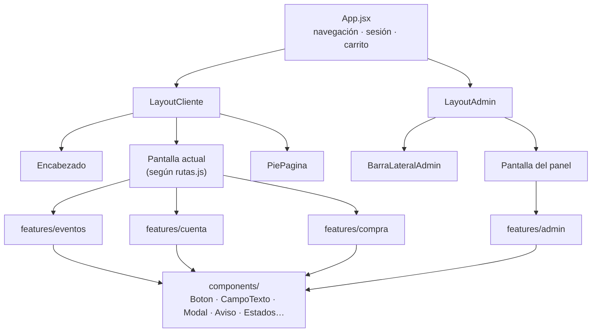
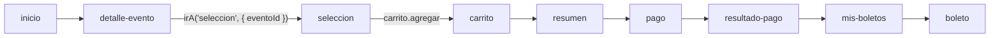

# Arquitectura de componentes y flujo de estado

> ✏️ Documento breve que pide la entrega. Completar al final con los componentes reales de cada módulo.

## Árbol de componentes

## Flujo de estado

1. **App.jsx** es dueño de tres estados: la vista actual (`useState`), la sesión (`useSesion`) y el carrito (`useCarrito`).
2. Los pasa como props a los layouts y a la pantalla actual: `{ params, irA, sesion, carrito }`.
3. Las pantallas no cambian el estado de App directamente: llaman a funciones (`irA`, `carrito.agregar`, `sesion.iniciarSesion`) y App vuelve a dibujar lo que corresponda.
4. Cada pantalla pide sus propios datos con `usePeticion`, que maneja carga, error y cancelación.
5. Sesión, carrito, órdenes y preferencias se guardan en `localStorage` con `useLocalStorage`.

## Flujo principal de compra

Si una vista pide sesión y no la hay, App muestra `login` y, al iniciar sesión, regresa a la vista que se había pedido.

## Decisiones

- ✏️ Completar.
