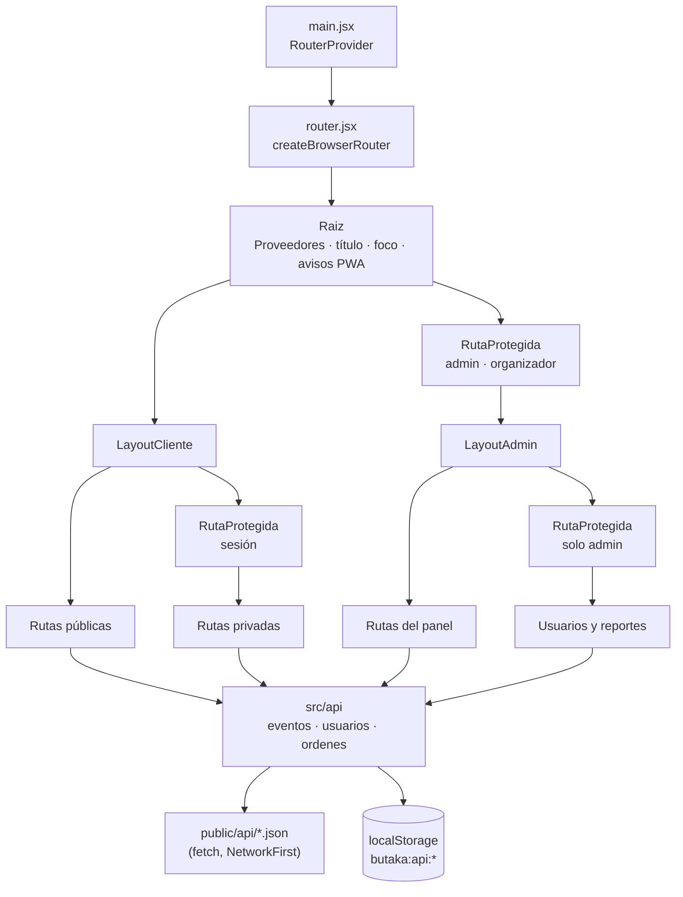
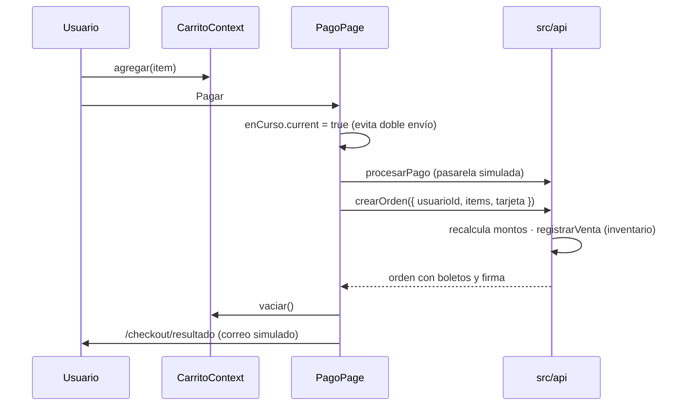

# Arquitectura y decisiones

Documento breve de cómo está construida la entrega final de Butaka y por qué.

## Vista general

## Decisiones

| Decisión | Alternativa descartada | Por qué |
|---|---|---|
| Cada módulo registra sus rutas y su Context en `features/*/modulo.jsx`; el router los descubre con `import.meta.glob` | Un solo archivo de rutas que todos editan | Los dos integrantes trabajamos sin depender del otro: nadie edita archivos ajenos para agregar una pantalla, y no hubo conflictos de merge |
| React Router en modo datos con layouts anidados y rutas protegidas como rutas sin path | Proteger dentro de cada pantalla | La protección queda en un solo lugar (`RutaProtegida`) y se ve en el árbol de rutas |
| Filtros en la URL (`/eventos?q=`, `/admin/reportes?periodo=`, `/admin/inventario?evento=`) | Estado local | Se pueden recargar, compartir y usar con el botón Atrás |
| Context + `useReducer` con acciones con nombre (`carrito/agregar`) y persistencia en un efecto | `useState` con funciones sueltas | Cada cambio de estado es explícito, el reductor es una función pura y fácil de probar |
| API falsa local: semilla JSON por `fetch` + escrituras en `localStorage` | DummyJSON | No depende de un servicio externo, los datos son del dominio de eventos y la caché del service worker puede guardar las respuestas |
| La API recalcula montos y descuenta inventario al crear la orden | Confiar en los totales del carrito | Simula lo que haría un servidor real y mantiene inventario y reportes consistentes |
| Reportes como funciones puras sobre las órdenes (`analitica.js`) | Datos estáticos | Cualquier compra nueva cambia los reportes al instante |
| Órdenes de prueba generadas con un script que cuadra con los `vendidos` | Escribirlas a mano | Más de 500 órdenes coherentes y repetibles |
| QR con la librería `qrcode` dibujado como SVG, con un enlace de verificación firmado | QR simulado de la segunda entrega | Es escaneable de verdad y la firma permite detectar códigos alterados |
| `registerType: 'prompt'` + `clientsClaim` | Actualización automática | El usuario decide cuándo recargar (no pierde un formulario a medias) y la app funciona sin conexión desde la primera visita |
| Carga diferida del panel y de los boletos | Un solo paquete | Un cliente no descarga el código del panel ni la librería de QR si no los usa |

## Flujo de una compra

## Trabajo en equipo

- Rama `base` primero (router, API, contextos compartidos, GitHub Pages); después, cada integrante con sus propias ramas y pull requests en paralelo.
- Dueños por carpeta y contrato de hooks, rutas y API documentados en `CONTRIBUIR.md`.
- `main` compiló después de cada merge y el workflow publicó cada versión en GitHub Pages.
